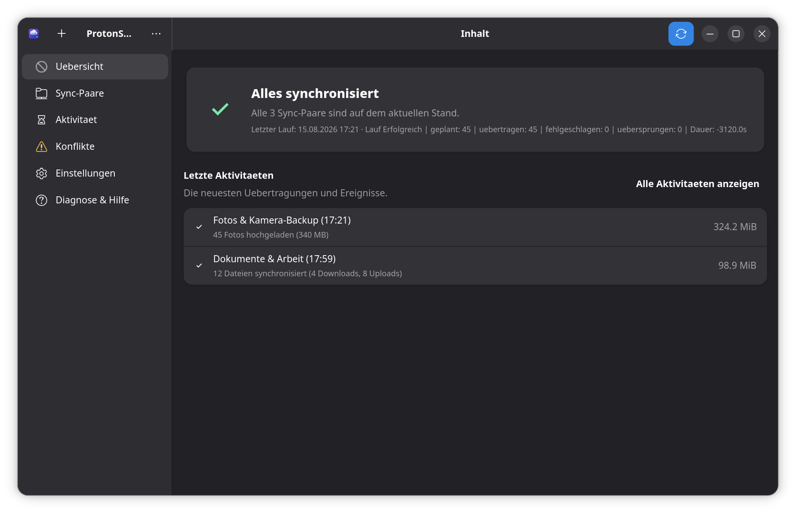
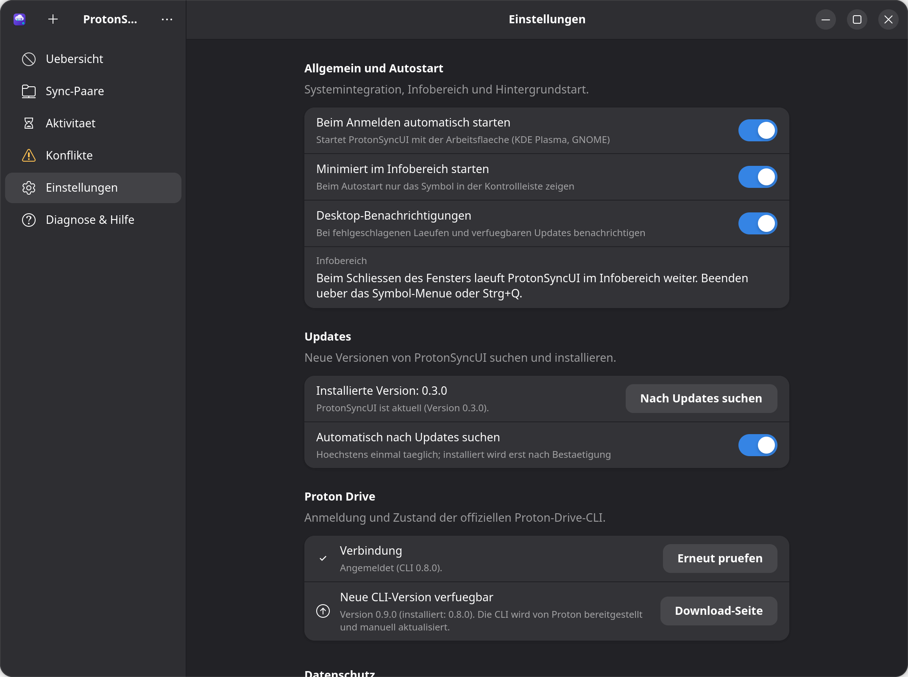

# ProtonSyncUI

<p align="center">
  
</p>

<p align="center">
  <b>A modern, native GTK4 & libadwaita desktop application for two-way synchronization and automated backups with Proton Drive on Linux.</b>
</p>

<p align="center">
  A project by <a href="https://stickelbroeck.com"><b>Stickelbroeck Labs</b></a> ·
  <a href="README.md">Deutsch</a> | <b>English</b>
</p>

---

## Highlights

- **True two-way sync (Cloud ⇄ Local)** – detects changes on both sides; upload-only and download-only modes are available too.
- **Native GNOME / libadwaita design** – adaptive layout, dark mode, German and English interface.
- **System tray & background operation** – `StatusNotifierItem` / `DBusMenu` (KDE Plasma, GNOME AppIndicator, XFCE, Sway/Waybar). The icon shows syncing, warnings and errors with a coloured badge and re-registers itself when the panel restarts.
- **Starts at login** – minimized in the tray if you like. The installation needs no virtual environment and survives distribution upgrades (e.g. Fedora 44 → 45).
- **Built-in updater** – checks at most once a day and installs only after you confirm, in the app or with `proton-sync-ui update`.
- **Proton Drive CLI in one click** – installs and updates the official CLI straight from proton.me, verified by SHA-512, keeping the previous version as a backup and your sign-in intact.
- **Graphical setup** – a single file sets up the application, autostart and the CLI without root privileges.
- **systemd user timers** – reliable background runs in your user session.
- **Visual conflict center** – one-click strategies: keep both, prefer local, prefer cloud.
- **Zero-knowledge & privacy** – no passwords or tokens ever pass through ProtonSyncUI; authentication stays with the official `proton-drive` CLI. No telemetry.
- **Never deletes remote data** – nothing is ever deleted on Proton Drive.
- **Headless CLI** – fully scriptable without a desktop.

## Screenshots

<p align="center">
  
</p>
<p align="center">
  
</p>

*The screenshots show the German interface; the application switches to English automatically on a
non-German desktop or under Settings → Language.*

## Requirements

| Distribution | Version | Dependencies |
|---|---|---|
| **Fedora / RHEL** | 41 – 45 (Python ≥ 3.13) | `sudo dnf install -y python3-gobject gtk4 libadwaita python3-cairo librsvg2-tools` |
| **Ubuntu / Debian** | Python ≥ 3.13 | `sudo apt install -y python3-gi python3-gi-cairo gir1.2-gtk-4.0 gir1.2-adw-1 libadwaita-1-0 librsvg2-bin` |
| **Arch Linux / Manjaro** | rolling | `sudo pacman -S --needed python-gobject gtk4 libadwaita python-cairo librsvg` |
| **openSUSE** | Tumbleweed | `sudo zypper install -y python3-gobject gtk4 libadwaita-1-0 python3-cairo librsvg-tools` |

## Installation

### Option A: Setup (recommended)

Download the setup from the [releases page](https://github.com/ST1CKEL/ProtonSyncUI-Linux/releases/latest) and run it:

```bash
sh ProtonSyncUI-Setup-0.4.0.run
```

A window guides you through language, autostart and setting up the Proton Drive CLI. Everything is
installed into your home directory. Without a graphical session (or with `--text`) the same
installation runs in the terminal.

### Option B: From source

```bash
git clone https://github.com/ST1CKEL/ProtonSyncUI-Linux.git
cd ProtonSyncUI-Linux
./install.sh              # add --autostart to start at login
```

### Sign in to Proton Drive

Click **Sign in** in the application (banner or *Settings → Proton Drive*), or run
`proton-drive auth login` in a terminal.

## Command line

```bash
proton-sync-ui status                 # state of all sync pairs
proton-sync-ui sync <NAME|UUID>       # run a sync
proton-sync-ui dry-run <NAME|UUID>    # show the plan without transferring anything
proton-sync-ui list                   # list sync pairs
proton-sync-ui systemd sync           # write/refresh the background timers
proton-sync-ui autostart on|off       # start at login
proton-sync-ui update [--check]       # update ProtonSyncUI
proton-sync-ui cli-update [--check]   # install or update the official Proton Drive CLI
proton-sync-ui doctor                 # check CLI, sign-in, systemd and database
```

The interface language can be forced with `PROTON_SYNC_UI_LANGUAGE=de|en`. The command-line output
itself is currently German.

## Documentation

The detailed guides in [`docs/`](docs/) are written in German:
[User guide](docs/USER_GUIDE.md) · [Architecture](docs/ARCHITECTURE.md) ·
[Installation](docs/INSTALL.md) · [CLI reference](docs/CLI_REFERENCE.md) ·
[Troubleshooting](docs/TROUBLESHOOTING.md)

## Development

```bash
./install.sh --dev                                   # launchers use this source tree
python3 -m venv --system-site-packages .venv && .venv/bin/pip install -e ".[dev]"
PYTHONPATH=src python3 -m pytest
ruff check . && ruff format --check .
tools/build-setup.sh                                 # dist/ProtonSyncUI-Setup-<version>.run
```

## Uninstall

```bash
./uninstall.sh            # keeps configuration and database
./uninstall.sh --purge    # removes them as well
```

Files on Proton Drive are never touched.

## License

MIT – see [LICENSE](LICENSE).
