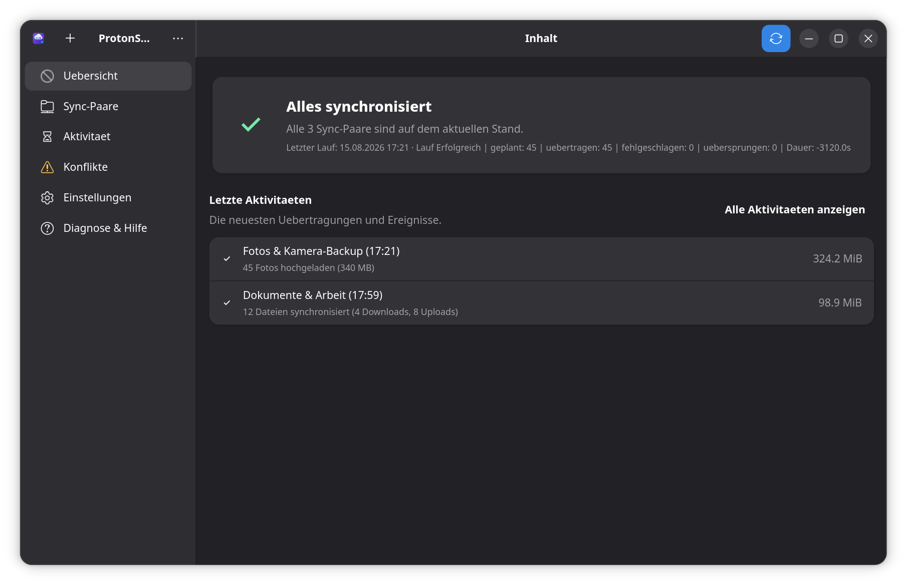
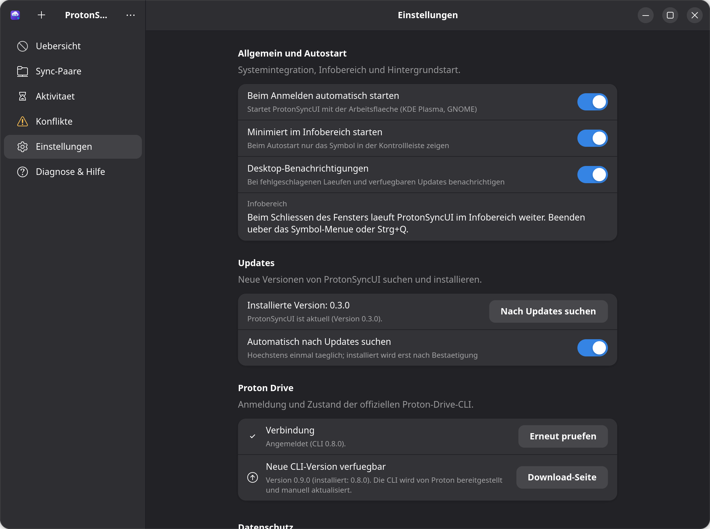
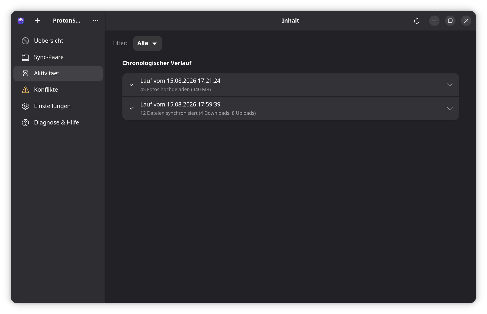
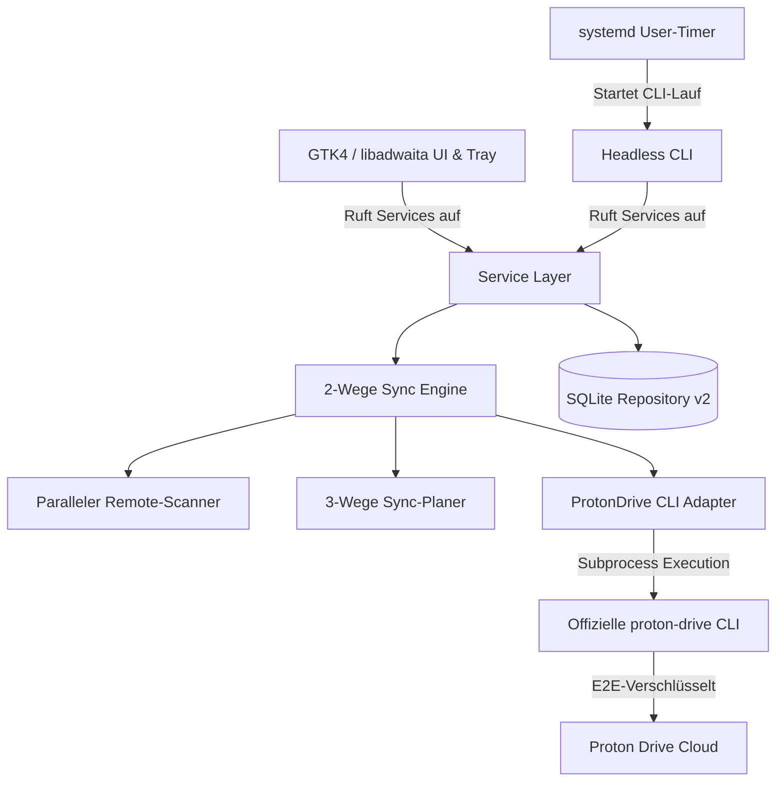

# ProtonSyncUI

<p align="center">
  
</p>

<p align="center">
  <b>Moderne, native GTK4 & libadwaita Desktop-Anwendung für Zwei-Wege-Synchronisation und automatische Backups mit Proton Drive.</b>
</p>

<p align="center">
  <a href="https://github.com/ST1CKEL/ProtonSyncUI-Linux"></a>
  
  
  
  
  
  
  
</p>

---

## 🌟 Highlights & Funktionen

- 🔄 **Echte 2-Wege-Synchronisation (Cloud ⇄ Lokal)**: Erkennt Änderungen auf beiden Seiten und gleicht sie nahtlos ab. Unterstützt zudem reine Upload- und Download-Modi.
- 🎨 **Modernes GNOME / libadwaita Design**: Folgt den GNOME Human Interface Guidelines (HIG) mit adaptivem Layout (`Adw.NavigationSplitView`), Dark-Mode-Unterstützung und flüssigen Animationen.
- 📥 **System-Tray & Hintergrund-Betrieb**: Läuft im Infobereich über das standardisierte `StatusNotifierItem` & `DBusMenu`-Protokoll (KDE, GNOME AppIndicator, XFCE, Sway/Waybar).
- ⏱️ **systemd User-Timer**: Vollständig integrierte, native Hintergrundsynchronisation im Benutzerprofil (`systemd --user`) – zuverlässig, ressourcenschonend und ohne Root-Rechte.
- ⚖️ **Visuelles Konflikt-Center**: Bei gleichzeitigen Änderungen schützt ProtonSyncUI deine Daten mit 1-Klick-Lösungsstrategien (*Beide behalten*, *Lokal bevorzugen*, *Cloud bevorzugen*).
- 🛡️ **100% Zero-Knowledge & Datenschutz**: Keine Weitergabe von Passwörtern oder Tokens; die kryptografische Authentifizierung verbleibt vollständig bei der offiziellen `proton-drive` CLI. 0% Telemetrie.
- ⚡ **Crash-Sicherheit & Atomarer Schutz**: Speicherung des Zustands in einer SQLite-Datenbank (Schema v2). Keine doppelten Übertragungen bei Verbindungsabbrüchen.
- 🖥️ **Headless CLI**: Volle Steuerbarkeit auch auf Servern oder in Skripten ohne Desktop-Umgebung.

---

## 📸 Benutzeroberfläche & Screenshots

### 1. Übersicht & Schnellzugriff (`Overview`)
> Live-Status aller Sync-Paare, Hero-Statuskarte, Schnellabgleich mit 1-Klick ("Alle synchronisieren") und Anzeige der letzten Aktivitäten.

<p align="center">
  
</p>

---

### 2. Sync-Paare verwalten (`Sync Pairs`)
> Übersichtliche Boxed-Cards je Ordnerpaar mit Status-Badges, Schnellumschaltern für automatische Läufe, Dry-Run-Simulation und Einzelfortschrittsanzeige.

<p align="center">
  
</p>

---

### 3. Visuelles Konflikt-Center (`Conflicts`)
> Automatische Erkennung divergierender Dateistände mit übersichtlicher 2-Spalten-Gegenüberstellung und 1-Klick-Lösungsstrategien.

<p align="center">
  
</p>

---

### 4. Einstellungen & System-Integration (`Settings`)
> Konfiguration von Desktop-Benachrichtigungen, Autostart beim Anmelden (auch minimiert im Infobereich) und Live-CLI-Diagnose.

<p align="center">
  
</p>

---

### 5. Aktivitäts- & Historienverlauf (`Activity`)
> Lückenloser Verlauf aller Synchronisationen, geplante Übertragungen, Dateifehler und detaillierte Kennzahlen (übertragene Datenmenge, Dauer).

<p align="center">
  
</p>

---

## 🏗️ Architektur & Funktionsweise

ProtonSyncUI setzt auf eine strikte Schichtenarchitektur (Clean Architecture) mit robuster Trennung von Benutzeroberfläche, Synchronisationslogik und CLI-Infrastruktur:



### 3-Wege-Abgleich (Sync Matrix)
Der Planer vergleicht den Zustand des lokalen Dateisystems, den Remote-Zustand auf Proton Drive und den in SQLite gespeicherten Stand des letzten erfolgreichen Laufs:

| Lokaler Zustand | Cloud-Zustand | DB-Zustand (Letzter Sync) | Geplante Aktion |
|---|---|---|---|
| Neu angelegt | Nicht vorhanden | Nicht vorhanden | **Upload (Neu)** |
| Nicht vorhanden | Neu angelegt | Nicht vorhanden | **Download (Neu)** |
| Geändert | Unverändert | Gespeichert | **Upload (Aktualisierung)** |
| Unverändert | Geändert | Gespeichert | **Download (Aktualisierung)** |
| Geändert | Geändert | Gespeichert | ⚠️ **Konflikt erkannt (Archivierung / Lösungsdialog)** |
| Gelöscht | Vorhanden | Gespeichert | **Lokal gelöscht** *(Remote-Kopie bleibt geschützt erhalten)* |
| Unverändert | Unverändert | Gespeichert | **Überspringen (Identisch)** |

---

## 📋 Systemanforderungen & Distributionen

| Distribution | Mindestversion | Paketmanager | Installationsbefehl für Abhängigkeiten |
|---|---|---|---|
| **Fedora / RHEL** | 39, 40, 41, 42, 43, 44 | `dnf` | `sudo dnf install -y python3-gobject gtk4 libadwaita python3-cairo librsvg2-tools` |
| **Ubuntu / Debian** | Ubuntu 24.04+, Debian 12+ | `apt` | `sudo apt install -y python3-gi python3-gi-cairo gir1.2-gtk-4.0 gir1.2-adw-1 libadwaita-1-0 librsvg2-bin` |
| **Arch Linux / Manjaro** | Rolling Release | `pacman` | `sudo pacman -S --needed python-gobject gtk4 libadwaita python-cairo librsvg` |
| **openSUSE** | Tumbleweed / Leap 15.6+ | `zypper` | `sudo zypper install -y python3-gobject gtk4 libadwaita-1-0 python3-cairo librsvg-tools` |

---

## 🚀 Installation & Schnellstart

### 1. Repository klonen
```bash
git clone https://github.com/ST1CKEL/ProtonSyncUI-Linux.git
cd ProtonSyncUI-Linux
```

### 2. Automatisierten Installer ausführen
```bash
chmod +x install.sh
./install.sh
```

*(Für automatisierte/nicht-interaktive Installationen: `./install.sh -y`)*

### 3. Bei Proton Drive anmelden (falls noch nicht erfolgt)
```bash
proton-drive auth login
```

### 4. Anwendung starten
* **Über die Anwendungsübersicht**: Nach `ProtonSyncUI` suchen.
* **Über das Terminal**:
  ```bash
  proton-sync-ui-gui
  ```
* **Minimiert im Infobereich starten**:
  ```bash
  proton-sync-ui-gui --minimized
  ```

---

## ⌨️ CLI-Befehlsreferenz (Headless-Betrieb)

ProtonSyncUI lässt sich auch auf Servern oder in eigenen Skripten steuern:

```bash
# Status aller Paare anzeigen
proton-sync-ui status

# Synchronisation für ein Paar starten
proton-sync-ui run <PAIR-UID-ODER-NAME>

# Dry-Run (Simulation) ohne Änderungen
proton-sync-ui dry-run <PAIR-UID-ODER-NAME>

# Alle konfigurierten Paare auflisten
proton-sync-ui list

# systemd Timer aktualisieren
proton-sync-ui systemd sync

# Aktuelle Protokolldatei einsehen
proton-sync-ui logs
```

---

## 📚 Ausführliche Dokumentation

Weitere detaillierte Anleitungen und technische Referenzen findest du im Ordner [`docs/`](docs/):

* 📖 **[Benutzerhandbuch (User Guide)](docs/USER_GUIDE.md)** – Vollständige Anleitung zur Konfiguration, Konfliktlösung und Benutzeroberfläche.
* 🏛️ **[Architektur & Design](docs/ARCHITECTURE.md)** – Tiefgehende Systemdokumentation, Schichtenmodell, SQLite Schema und Scanner-Pipeline.
* 📦 **[Installationsanleitung](docs/INSTALL.md)** – Detaillierte Anleitung für alle Linux-Distributionen & manuelle Einrichtung.
* 💻 **[CLI-Referenz](docs/CLI_REFERENCE.md)** – Headless-Nutzung, Scripting, Exit-Codes und Automatisierung.
* 🔧 **[Fehlerbehebung (Troubleshooting)](docs/TROUBLESHOOTING.md)** – Diagnoseleitfaden für Schlüsselbunde, Berechtigungen und Logs.
* ⏱️ **[systemd Integration](systemd/README-systemd.md)** – Funktionsweise der User-Units und Hintergrund-Timer.

---

## 🛠️ Entwicklung & Tests

```bash
# Entwicklerumgebung einrichten
./install.sh --dev

# Virtuelle Umgebung aktivieren
source ~/.local/share/proton-sync-ui/venv/bin/activate

# Testsuite ausführen (406 Tests)
PYTHONPATH=src pytest

# Code-Qualität & Formatierung prüfen
ruff check .
ruff format --check .

# Typanalyse
mypy
```

---

## 🗑️ Deinstallation

```bash
# Standard-Deinstallation (Konfiguration und Datenbank bleiben erhalten)
./uninstall.sh

# Vollständige Bereinigung (inklusive lokaler Datenbank und Logs)
./uninstall.sh --purge
```

---

## 📄 Lizenz

Dieses Projekt ist unter der **MIT-Lizenz** lizenziert. Siehe [LICENSE](LICENSE) für weitere Details.
