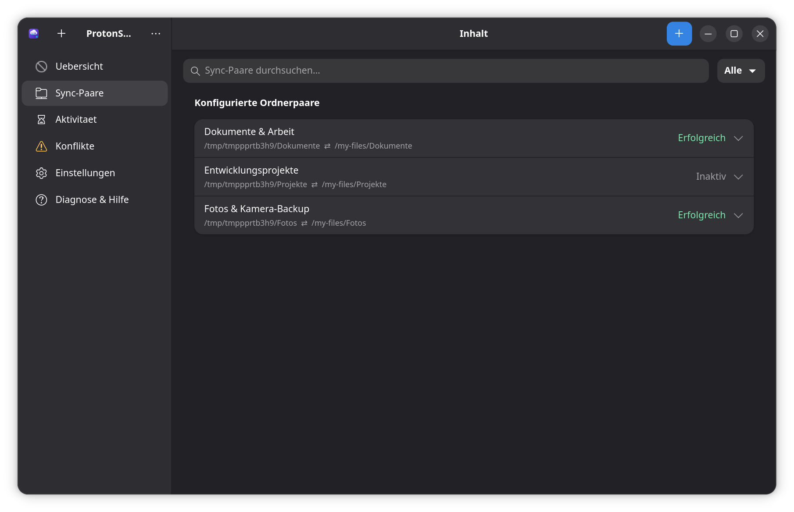
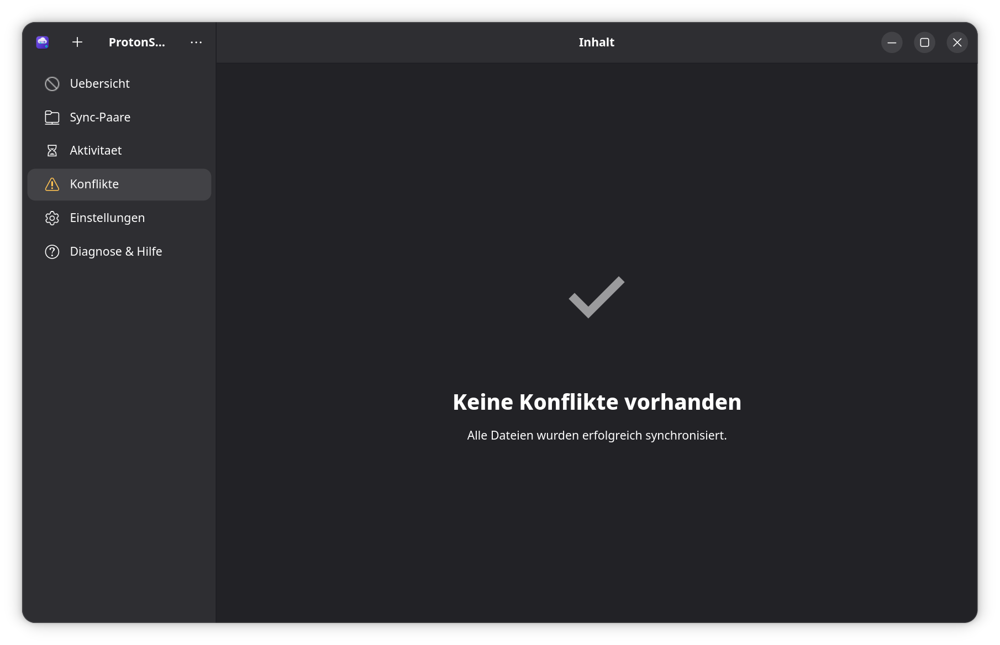

# ProtonSyncUI

<p align="center">
  
</p>

<p align="center">
  <b>Moderne, native GTK4 & libadwaita Desktop-Anwendung für Zwei-Wege-Synchronisation und automatische Backups mit Proton Drive.</b>
</p>

<p align="center">
  <a href="https://github.com/ST1CKEL/ProtonSyncUI-Linux"></a>
  
  
  
  
  
  
  
</p>

---

## 🌟 Über das Projekt

**ProtonSyncUI** ist ein eleganter, ressourcenschonender und sicherer Linux-Desktop-Client zur Synchronisation lokaler Ordner mit **Proton Drive**. 

Die Anwendung verhält sich wie gewohnte Cloud-Sync-Clients (z. B. Nextcloud, Dropbox oder Google Drive) und bietet neben der grafischen libadwaita-Oberfläche eine vollständige **System-Tray-Integration (StatusNotifierItem)**, einen **Hintergrund-Betrieb** sowie automatische **systemd-Hintergrund-Timer**.

---

## 📸 Screenshots & Benutzeroberfläche

### 1. Übersicht (Hero-Statuskarte & Schnellstart)
> Live-Status aller Sync-Paare, Schnellabgleich mit 1-Klick ("Alle synchronisieren") und Anzeige der letzten Synchronisationsläufe.


---

### 2. Sync-Paare (Konfiguration & Verwaltung)
> Detaillierte Boxed-Cards je Ordnerpaar mit Status-Badges, Schnellumschalter für automatische Läufe, Dry-Run-Simulation und Einzelfortschritt.



---

### 3. Visuelles Konflikt-Center (2-Spalten-Gegenüberstellung)
> Automatische Erkennung divergierender Dateistände mit 1-Klick-Lösungsstrategien (*Beide behalten*, *Lokal bevorzugen*, *Cloud bevorzugen*).



---

### 4. Einstellungen & Autostart
> System-Integration, Desktop-Benachrichtigungen, automatischer Start beim Anmelden (auch minimiert im Infobereich) und Live-CLI-Diagnose.


---

### 5. Aktivitäts- und Historienverlauf
> Lückenloser Verlauf aller Synchronisationen, geplante Übertragungen, Dateifehler und detaillierte Kennzahlen.


---

## 📋 Systemanforderungen

ProtonSyncUI unterstützt alle modernen Linux-Distributionen (Wayland & X11).

### Unterstützte Linux-Distributionen
| Distribution | Mindestversion | Paketmanager | Installationsbefehl für Abhängigkeiten |
|---|---|---|---|
| **Fedora / RHEL** | 39, 40, 41, 42, 43, 44 | `dnf` | `sudo dnf install python3-gobject gtk4 libadwaita python3-cairo librsvg2-tools` |
| **Ubuntu / Debian** | Ubuntu 24.04+, Debian 12+ | `apt` | `sudo apt install python3-gi python3-gi-cairo gir1.2-gtk-4.0 gir1.2-adw-1 libadwaita-1-0 librsvg2-bin` |
| **Arch Linux / Manjaro** | Rolling Release | `pacman` | `sudo pacman -S python-gobject gtk4 libadwaita python-cairo librsvg` |
| **openSUSE** | Tumbleweed / Leap 15.6+ | `zypper` | `sudo zypper install python3-gobject gtk4 libadwaita-1-0 python3-cairo librsvg-tools` |

*(Hinweis: Das mitgelieferte `install.sh`-Skript erkennt deine Distribution automatisch und installiert fehlende Systempakete selbstständig.)*

### Software- und System-Voraussetzungen
* **Python**: Version `3.10` oder neuer (vollständig kompatibel mit Python 3.11, 3.12, 3.13, 3.14).
* **Desktop-Umgebung**: 
  * **GNOME 45+** (Standard-Design via libadwaita)
  * **KDE Plasma 5 / 6** (Native StatusNotifierItem-Tray-Unterstützung)
  * **XFCE, Cinnamon, MATE, Cosmic, Hyprland, Sway**
* **Proton Drive CLI**: `proton-drive` Kommandozeile (installiert im Benutzerpfad, z. B. via `pip` oder `pipx`).
* **Hintergrunddienste**:
  * `systemd --user` für zeitgesteuerte Hintergrund-Synchronisation.
  * D-Bus Session-Bus für das Infobereich-/Taskleisten-Symbol (`StatusNotifierItem` & `DBusMenu`).

---

## 🛡️ Sicherheitsmodell & Datenschutz

* **🔒 100% Zero-Knowledge & Datenschutz**: ProtonSyncUI speichert **keine Passwörter, Sitzungstokens oder Zugangsdaten**. Die kryptografische Authentifizierung verbleibt vollständig bei der offiziellen `proton-drive` CLI.
* **🛡️ Schutz vor Datenverlust**: Bei Uploads wird standardmäßig `-f create-new-revision` und `-d merge` genutzt. Bestehende Cloud-Dateien werden niemals versehentlich überschrieben oder remote gelöscht.
* **⚡ Crash-Sicherheit**: Jede übertragene Datei wird atomar in einer lokalen SQLite-Datenbank festgehalten. Bei Abbrüchen (z. B. Systemneustart oder Verbindungsverlust) wird die Synchronisation nahtlos und ohne doppelte Übertragungen fortgesetzt.
* **🚫 0% Telemetrie**: Keine Tracking-Tools, keine Analyse-Server, kein Web-Port – 100% lokale Ausführung.

---

## 🚀 Installation & Schnellstart

### 1. Repository klonen
```bash
git clone git@github.com:ST1CKEL/ProtonSyncUI-Linux.git
cd ProtonSyncUI-Linux
```

### 2. Automatisierten Installer ausführen
```bash
chmod +x install.sh
./install.sh
```

> **Automatisierte Installation (z. B. ohne interaktive Rückfragen):**
> ```bash
> ./install.sh -y
> ```

### 3. Einmalig bei Proton Drive anmelden (falls noch nicht erfolgt)
```bash
proton-drive auth login
```

### 4. ProtonSyncUI starten
* Über das **Startmenü / Anwendungsübersicht**: Nach `ProtonSyncUI` suchen.
* Über das **Terminal (GUI)**:
  ```bash
  proton-sync-ui-gui
  ```
* Im **Hintergrund minimiert starten**:
  ```bash
  proton-sync-ui-gui --minimized
  ```
* Über das **Terminal (CLI Statusabfrage)**:
  ```bash
  proton-sync-ui status
  ```

---

## 💡 System-Tray & Hintergrund-Betrieb

* **Minimieren ins Tray**: Beim Klick auf das Schließen-Kreuz (`X`) schließt sich das Fenster nicht komplett, sondern minimiert sich lautlos in die Taskleiste.
* **Kontextmenü in der Leiste**:
  * *ProtonSyncUI öffnen*
  * *Alle jetzt synchronisieren*
  * *Beenden* (`Strg+Q`)
* **Autostart**: In den *Einstellungen* kann der automatische Start beim System-Login (wahlweise direkt minimiert) mit einem Klick aktiviert werden.

> **💡 Hinweis für GNOME-Nutzer (Fedora / Ubuntu):**  
> GNOME blendet System-Tray-Icons standardmäßig aus. Um das Icon in der oberen Leiste anzuzeigen, installiere die Standard-Erweiterung:
> ```bash
> # Fedora:
> sudo dnf install gnome-shell-extension-appindicator
> # Ubuntu / Debian:
> sudo apt install gnome-shell-extension-appindicator
> ```

---

## ⌨️ CLI-Befehlsreferenz

ProtonSyncUI lässt sich auch vollständig ohne grafische Oberfläche auf Servern oder in Skripten steuern:

```bash
# Status aller konfigurierten Sync-Paare anzeigen
proton-sync-ui status

# Bestimmtes Sync-Paar synchronisieren
proton-sync-ui run <PAIR-UID-ODER-NAME>

# Dry-Run (Vorschau / Simulation) ausführen
proton-sync-ui dry-run <PAIR-UID-ODER-NAME>

# Alle Paare tabellarisch auflisten
proton-sync-ui list

# systemd Timer im Benutzerprofil aktualisieren
proton-sync-ui systemd sync

# Protokolldatei einsehen
proton-sync-ui logs
```

---

## 🏗️ Projektstruktur

```
ProtonSyncUI-Linux/
├── data/                                 # Desktop-Metadaten & Vektor-Symbole
│   ├── icons/io.github.protonsyncui.ProtonSyncUI.svg
│   └── io.github.protonsyncui.ProtonSyncUI.desktop
├── docs/                                 # Detaillierte Dokumentation & Screenshots
│   ├── ARCHITECTURE.md                   # Architektur, Clean Design & Datenfluss
│   ├── INSTALL.md                        # Distributions-spezifische Installationsanleitung
│   └── screenshots/                      # UI-Screenshots (Overview, Pairs, Conflicts, etc.)
├── src/proton_sync_ui/                   # Python-Quellpaket
│   ├── cli/                              # Headless CLI-Kommandos
│   ├── cli_adapter/                      # Sicherer Subprocess-Adapter für proton-drive
│   ├── models/                           # Datamodels (SyncPair, RunRecord, UploadPlan)
│   ├── services/                         # Service-Layer (Contracts, DefaultServices)
│   ├── storage/                          # SQLite Schema & Repository (v2)
│   ├── sync/                             # 2-Wege Sync Engine, Paralleler Scanner & Planer
│   ├── systemd/                          # systemd User-Timer & Service-Manager
│   └── ui/                               # GTK4 / libadwaita Desktop-App
│       ├── components/                   # StatusBadge, PairCardRow, ConflictCard
│       ├── views/                        # Overview, Pairs, Conflicts, Activity, Settings, Diag
│       ├── application.py                # Adw.Application Lebenszyklus & CLI-Optionen
│       ├── tray.py                       # StatusNotifierItem & DBusMenu Taskleisten-Dienst
│       └── window.py                     # Adw.NavigationSplitView Hauptfenster
├── tests/                                # 406 Unittests & UI Smoke Tests
├── install.sh                            # Multi-Distro Installer (Fedora, Debian, Arch, SUSE)
├── uninstall.sh                          # Sauberer Deinstaller
└── pyproject.toml                        # Build- & Abhängigkeitskonfiguration
```

---

## 🛠️ Entwicklung & Tests

```bash
# Entwicklerumgebung installieren
./install.sh --dev

# Virtuelle Umgebung aktivieren
source ~/.local/share/proton-sync-ui/venv/bin/activate

# Testsuite ausführen (406 Tests)
pytest

# Code-Qualität & Formatierung prüfen
ruff check .
ruff format --check .

# Statische Typprüfung
mypy
```

---

## 🗑️ Deinstallation

```bash
# Standard-Entfernung (Konfiguration & Datenbank bleiben erhalten)
./uninstall.sh

# Vollständige Bereinigung inklusive lokaler Datenbank und Logs
./uninstall.sh --purge
```

---

## 📄 Lizenz

Dieses Projekt ist unter der **MIT-Lizenz** lizenziert. Siehe [LICENSE](LICENSE) für Details.
