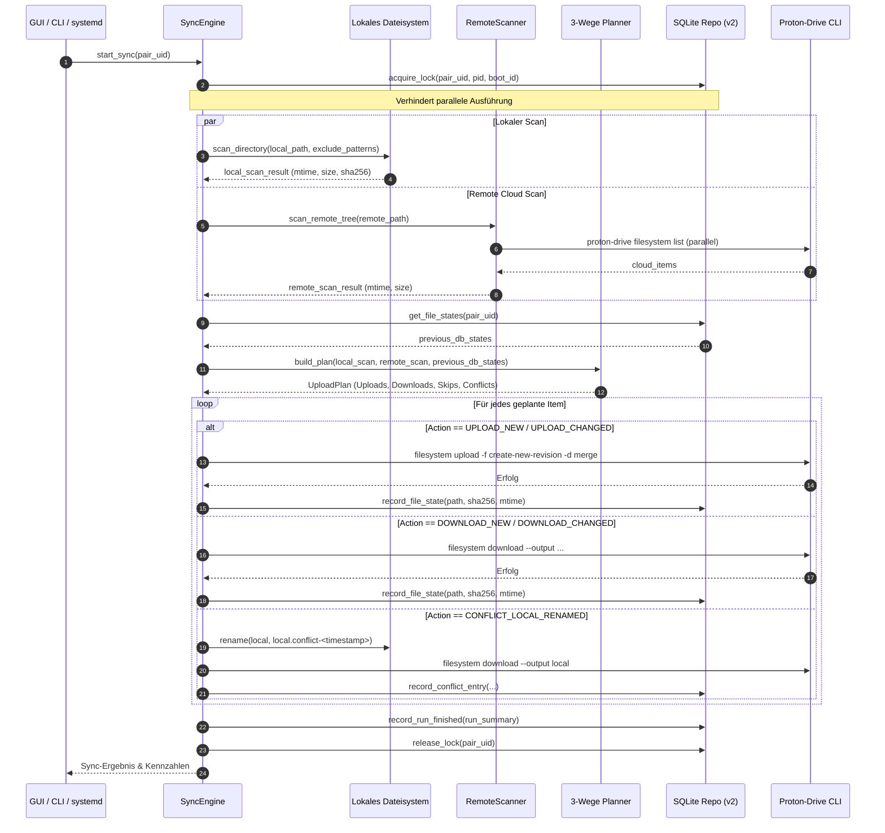
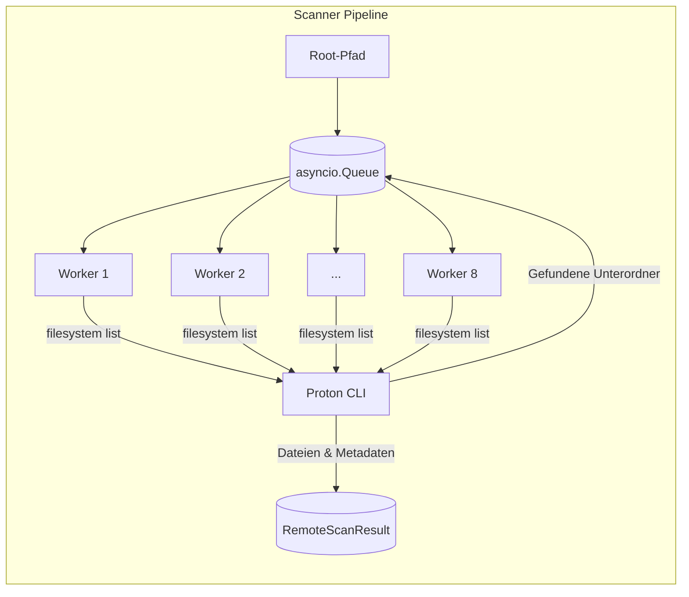

# Architektur & Komponenten-Design von ProtonSyncUI

Dieses Dokument beschreibt die interne Systemarchitektur, Datenflüsse, Entwurfsmuster und Sicherheitsgarantien von **ProtonSyncUI (v0.4.0)**.

---

## 1. Schichtenarchitektur (Clean Architecture)

ProtonSyncUI folgt dem Prinzip der sauberen Schichtentrennung. Abhängigkeiten verlaufen strikt von außen nach innen:

```
┌─────────────────────────────────────────────────────────────┐
│                    Präsentationsschicht                     │
│  (Adw.NavigationSplitView, Views, StatusBadge, PairCardRow)  │
│  (StatusNotifierItem Tray & DBusMenu Taskleisten-Dienst)    │
└──────────────────────────────┬──────────────────────────────┘
                               │ Ruft Services auf
                               ▼
┌─────────────────────────────────────────────────────────────┐
│                       Service-Schicht                       │
│  (SyncService, SyncPairRepository, ConflictService, Activity)│
│  (AsyncRunner, PreflightChecks, SystemNotification)         │
└──────────────────────────────┬──────────────────────────────┘
                               │ Nutzt Kern-Module
                               ▼
┌─────────────────────────────────────────────────────────────┐
│                     Domänen- & Engine-Kern                  │
│   (SyncEngine, TwoWayPlanner, RemoteScanner, SQLite Repo)   │
│   (Models: SyncPair, UploadPlan, PlanItem, RunRecord)       │
└──────────────────────────────┬──────────────────────────────┘
                               │ Delegiert an CLI / OS
                               ▼
┌─────────────────────────────────────────────────────────────┐
│                  Infrastruktur & Adapter                    │
│      (ProtonDriveAdapter Subprocess, systemd User Manager)  │
│      (File Lock Manager, Log Redaction & Safe Formatter)    │
└─────────────────────────────────────────────────────────────┘
```

---

## 2. Der 2-Wege-Synchronisationsfluss

Ein Synchronisationslauf durchläuft mehrere deterministische Phasen:



---

## 3. Asynchroner Remote-Scanner (Pipeline)

Der Remote-Scanner (`src/proton_sync_ui/sync/remote_scanner.py`) liest Verzeichnisstrukturen auf Proton Drive parallel und asynchron aus:



* **8 Worker-Tasks**: Standardmäßig bis zu 8 parallele Abfragen für maximale Geschwindigkeit bei tiefen Ordnerstrukturen.
* **Non-Blocking**: Liefert kontinuierlich Fortschrittstickets an die Benutzeroberfläche.
* **Fehlertoleranz**: Ordner, auf die keine Zugriffsrechte bestehen, werden isoliert als Scan-Warnung erfasst, ohne den Gesamtabgleich abzubrechen.

---

## 4. 3-Wege-Planungsmatrix

Der Planer (`src/proton_sync_ui/sync/planner.py`) vergleicht für jeden Pfad drei Instanzen:
1. **L** = Lokaler Zustand (Dateisystem)
2. **R** = Entfernter Zustand (Proton Drive)
3. **S** = Gespeicherter Zustand (SQLite Datenbank beim letzten erfolgreichen Sync)

```
        ┌────────────────────────────────────────┐
        │  3-Wege-Entscheidungsbaum je Datei     │
        └───────────────────┬────────────────────┘
                            │
            ┌───────────────┴───────────────┐
            ▼                               ▼
    [In DB vorhanden]             [In DB NICHT vorhanden]
            │                               │
    ┌───────┴───────┐               ┌───────┴───────┐
    ▼               ▼               ▼               ▼
L verändert?    R verändert?    L vorhanden?    R vorhanden?
  Ja/Nein         Ja/Nein         Ja/Nein         Ja/Nein
```

### Entscheidungslogik im Detail:
- **`L == verändert`, `R == unberührt`**: `UPLOAD_CHANGED` (lokale Datei zur Cloud übertragen).
- **`L == unberührt`, `R == verändert`**: `DOWNLOAD_CHANGED` (Cloud-Datei herunterladen).
- **`L == verändert`, `R == verändert`**: `CONFLICT_LOCAL_RENAMED` (Konflikt: lokale Datei wird gesichert, Cloud-Fassung heruntergeladen).
- **`L == gelöscht`, `R == vorhanden`**: `LOCAL_DELETED` (Kopie in der Cloud bleibt gemäß Sicherheitsrichtlinie geschützt erhalten). Der DB-Eintrag bleibt als *Grabstein* (`file_states.deleted = 1`) bestehen, damit die Datei nicht beim nächsten Lauf erneut heruntergeladen wird. Ändert sich die Cloud-Fassung danach, wird sie wieder als `DOWNLOAD_NEW` geladen.
- **`L == vorhanden`, `R == vorhanden`, kein DB-Eintrag** (erster Abgleich): gleiche Größe → `SKIP_UNCHANGED`, der Stand wird als synchron vermerkt; andere Größe → `CONFLICT_LOCAL_RENAMED`, die lokale Fassung wird also nie ungesichert überschrieben.
- **`L == neu`, `R == nicht vorhanden`**: `UPLOAD_NEW` (neue Datei hochladen).
- **`L == nicht vorhanden`, `R == neu`**: `DOWNLOAD_NEW` (neue Datei herunterladen).

### Downloads
Die CLI lädt zunächst in ein verstecktes Staging-Verzeichnis (`.proton-sync-ui-dl-*`) neben der Zieldatei. Erst nach einem vollständigen Download wird bei einem Konflikt die lokale Fassung als `name.conflict-<Unix-Zeit>.ext` gesichert und die neue Datei atomar an ihren Platz gesetzt. Schlägt die Sicherung fehl, bleibt die lokale Datei unverändert. Staging-Verzeichnisse und Konfliktsicherungen sind standardmäßig vom Sync ausgenommen.

---

## 5. Datenhaltung & SQLite Schema (Version 2)

Alle Zustandsinformationen werden atomar in `~/.local/state/proton-sync-ui/database.sqlite` verwaltet:

```sql
-- Sync-Paare
CREATE TABLE sync_pairs (
    uid                 TEXT PRIMARY KEY,
    name                TEXT NOT NULL,
    local_path          TEXT NOT NULL,
    remote_path         TEXT NOT NULL,
    enabled             INTEGER NOT NULL DEFAULT 1,
    sync_mode           TEXT NOT NULL DEFAULT 'bidirectional',
    schedule_kind       TEXT NOT NULL DEFAULT 'manual',
    interval_minutes    INTEGER,
    exclude_patterns    TEXT NOT NULL DEFAULT '',
    max_file_size_bytes INTEGER,
    created_at          TEXT NOT NULL,
    updated_at          TEXT NOT NULL
);

-- Datei-Tracking (Synchronisationszustand)
CREATE TABLE file_states (
    pair_uid      TEXT NOT NULL,
    relative_path TEXT NOT NULL,
    size_bytes    INTEGER NOT NULL,
    mtime_ns      INTEGER NOT NULL,
    sha256        TEXT,
    remote_path   TEXT NOT NULL,
    remote_mtime  TEXT,
    uploaded_at   TEXT NOT NULL,
    PRIMARY KEY (pair_uid, relative_path),
    FOREIGN KEY (pair_uid) REFERENCES sync_pairs (uid) ON DELETE CASCADE
);

-- Historie aller Läufe
CREATE TABLE runs (
    id               INTEGER PRIMARY KEY AUTOINCREMENT,
    pair_uid         TEXT NOT NULL,
    dry_run          INTEGER NOT NULL DEFAULT 0,
    status           TEXT NOT NULL,
    started_at       TEXT NOT NULL,
    finished_at      TEXT,
    planned_files    INTEGER NOT NULL DEFAULT 0,
    uploaded_files   INTEGER NOT NULL DEFAULT 0,
    downloaded_files INTEGER NOT NULL DEFAULT 0,
    failed_files     INTEGER NOT NULL DEFAULT 0,
    skipped_files    INTEGER NOT NULL DEFAULT 0,
    local_deletions  INTEGER NOT NULL DEFAULT 0,
    uploaded_bytes   INTEGER NOT NULL DEFAULT 0,
    downloaded_bytes INTEGER NOT NULL DEFAULT 0,
    message          TEXT NOT NULL DEFAULT ''
);

-- Prozess-Sperren
CREATE TABLE run_locks (
    pair_uid       TEXT PRIMARY KEY,
    pid            INTEGER NOT NULL,
    boot_id        TEXT NOT NULL,
    pid_start_time INTEGER NOT NULL,
    acquired_at    TEXT NOT NULL,
    source         TEXT NOT NULL DEFAULT 'unknown'
);
```

---

## 6. Sicherheitsgarantien & Schutz vor Datenverlust

1. **🛡️ 100% Remote-Erhalt (No Remote Deletion)**:
   ProtonSyncUI führt unter keinen Umständen zerstörerische Kommandos wie `proton-drive filesystem delete`, `trash` oder `empty-trash` aus. Lokal gelöschte Dateien verbleiben sicher in der Cloud.
2. **🔒 Zero-Knowledge Prinzip**:
   Es werden keine Passwörter, Sitzungstokens oder kryptografische Schlüssel gespeichert. Die Authentifizierung obliegt ausschließlich der offiziellen `proton-drive` CLI.
3. **⚡ Automatische Bereinigung verwaister Sperren (Stale Locks)**:
   Abstürze oder Stromausfälle hinterlassen keine blockierenden Sperren. Beim Start prüft `src/proton_sync_ui/storage/locking.py`:
   - Stimmt die `boot_id` des Systems noch überein?
   - Existiert der Prozess mit `pid` noch?
   - Stimmt die `pid_start_time` in `/proc/<pid>/stat` überein?
   Ist die Sperre verwaist, wird sie atomar abgeräumt.
4. **🛡️ Subprocess-Sicherheit**:
   Aufrufe der CLI erfolgen strikt mit `shell=False` und vorformatierten Tokenlisten, um Injection-Angriffe prinzipiell auszuschließen.
5. **🔒 Automatische Log-Schwärzung**:
   Der Logger filtert Passwörter, Autorisierungstokens und geheime Schlüssel über reguläre Ausdrücke heraus (`redact()`), bevor sie in die Logdatei geschrieben werden.
