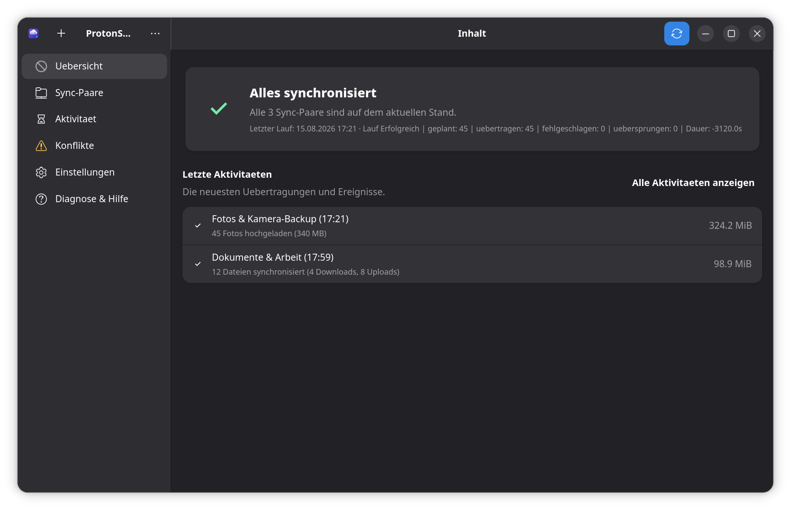
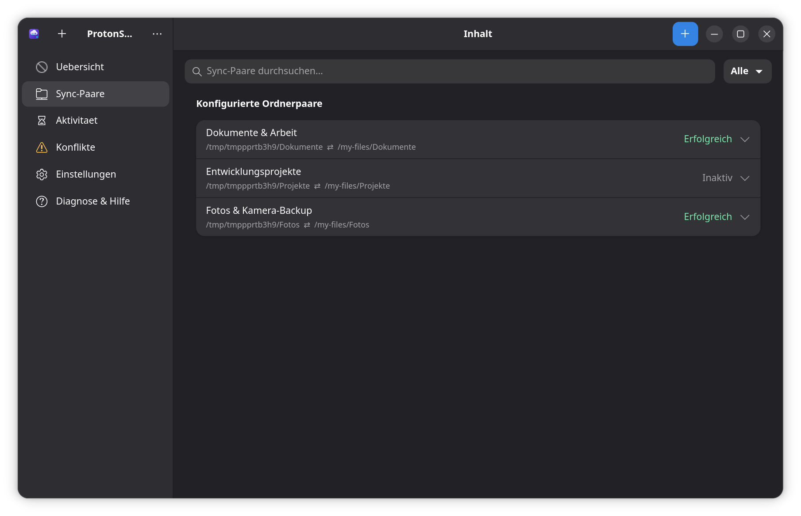
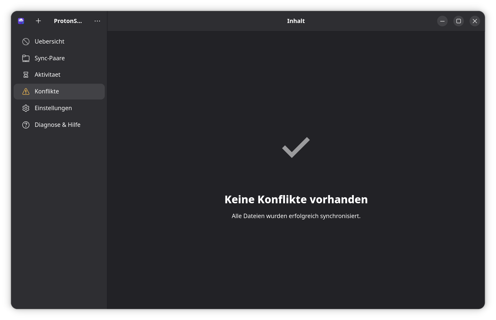
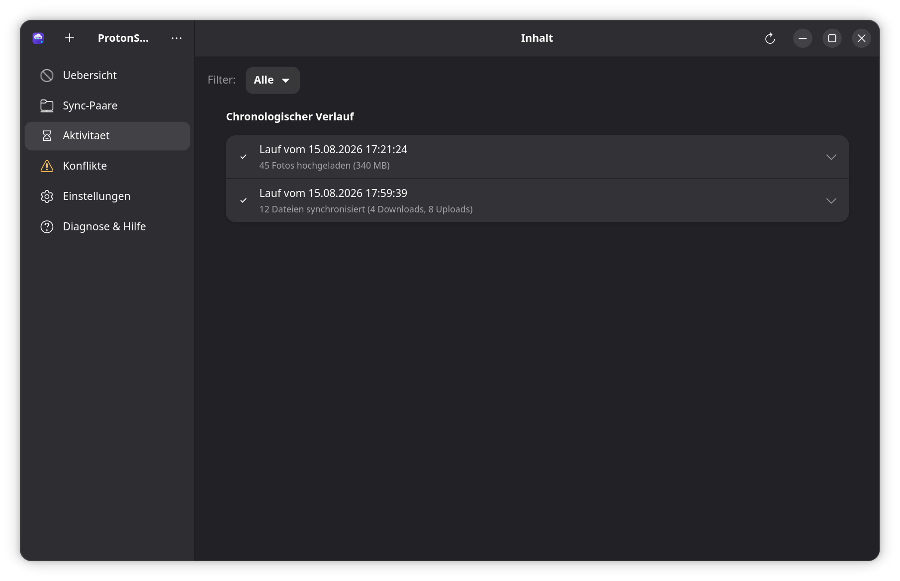
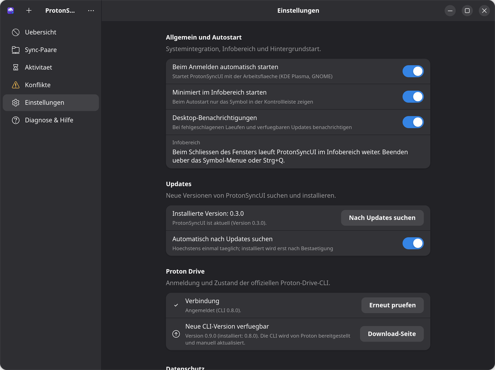

# ProtonSyncUI – Ausführliches Benutzerhandbuch

Willkommen beim offiziellen Benutzerhandbuch von **ProtonSyncUI**. Diese Anleitung führt dich Schritt für Schritt durch alle Funktionen, Konfigurationsoptionen und Best Practices für die Synchronisation deiner Daten mit Proton Drive unter Linux.

---

## 📑 Inhaltsverzeichnis

1. [Erste Schritte & Anmeldung](#1-erste-schritte--anmeldung)
2. [Die Benutzeroberfläche im Überblick](#2-die-benutzeroberfläche-im-überblick)
   - [Übersicht (Overview)](#übersicht-overview)
   - [Sync-Paare (Sync Pairs)](#sync-paare-sync-pairs)
   - [Konflikt-Center (Conflicts)](#konflikt-center-conflicts)
   - [Aktivitätsverlauf (Activity)](#aktivitätsverlauf-activity)
   - [Einstellungen (Settings)](#einstellungen-settings)
3. [Ein neues Sync-Paar einrichten](#3-ein-neues-sync-paar-einrichten)
   - [Synchronisationsmodi](#synchronisationsmodi)
   - [Zeitpläne (Manuell vs. Intervall)](#zeitpläne-manuell-vs-intervall)
   - [Ausschlussregeln (Exclude-Patterns)](#ausschlussregeln-exclude-patterns)
   - [Dateigrößenbeschränkungen](#dateigrößenbeschränkungen)
4. [Durchführen von Synchronisationen](#4-durchführen-von-synchronisationen)
   - [Manueller Schnellstart](#manueller-schnellstart)
   - [Dry-Run (Vorschau / Simulation)](#dry-run-vorschau--simulation)
   - [Automatische Hintergrundläufe](#automatische-hintergrundläufe)
5. [Konflikte verstehen und lösen](#5-konflikte-verstehen-und-lösen)
   - [Wie Konflikte entstehen](#wie-konflikte-entstehen)
   - [Die 3 Lösungsstrategien](#die-3-lösungsstrategien)
6. [System-Tray & Autostart](#6-system-tray--autostart)
   - [Tray-Steuerung](#tray-steuerung)
   - [Autostart-Konfiguration](#autostart-konfiguration)
   - [GNOME-AppIndicator-Einrichtung](#gnome-appindicator-einrichtung)
7. [Protokolle & Fehlerdiagnose](#7-protokolle--fehlerdiagnose)

---

## 1. Erste Schritte & Anmeldung

ProtonSyncUI setzt auf die offizielle Kommandozeile `proton-drive` auf. Bevor du ProtonSyncUI nutzt, muss die Erstanmeldung einmalig im Terminal durchgeführt werden:

```bash
proton-drive auth login
```

Folge den Anweisungen im Terminal:
1. Gib deinen Proton-Benutzernamen oder deine E-Mail-Adresse ein.
2. Gib dein Passwort ein.
3. Falls aktiviert, gib deinen Zwei-Faktor-Authentifizierungscode (2FA) ein.

> **🔒 Datenschutzhinweis:** ProtonSyncUI speichert weder dein Passwort noch Sitzungstokens. Die Anmeldesitzung wird sicher und verschlüsselt im Schlüsselbund deines Systems durch die offizielle Proton-CLI verwaltet.

Nach erfolgreicher Anmeldung kannst du ProtonSyncUI starten:
- Über deine Anwendungsübersicht: Nach **ProtonSyncUI** suchen.
- Im Terminal: `proton-sync-ui-gui`

---

## 2. Die Benutzeroberfläche im Überblick

ProtonSyncUI verwendet ein modernes, anpassungsfähiges `Adw.NavigationSplitView`-Layout nach den GNOME HIG-Richtlinien.

### Übersicht (Overview)

<p align="center">
  
</p>

Die Übersicht ist deine Steuerzentrale:
* **Hero-Statuskarte**: Zeigt dir auf einen Blick, ob alle Ordner aktuell sind oder ob Synchronisationen anstehen bzw. laufen.
* **Button "Alle synchronisieren"**: Startet den Abgleich für alle aktiven Sync-Paare mit einem einzigen Klick.
* **Letzte Aktivitäten**: Schneller Einblick in die jüngsten Synchronisationsergebnisse inklusive übertragener Dateianzahl und Datenvolumen.

---

### Sync-Paare (Sync Pairs)

<p align="center">
  
</p>

Hier verwaltest du alle eingerichteten Ordnerbeziehungen:
* **Status-Badges**: Farbige Indikatoren signalisieren den aktuellen Zustand (`Aktuell`, `Synchronisiert…`, `Deaktiviert`, `Warnung`, `Fehler`).
* **Schnellschalter**: Aktiviere oder deaktiviere einzelne Paare temporär.
* **Aktionsmenü je Karte**:
  * **Jetzt synchronisieren**: Startet die sofortige Ausführung.
  * **Simulation (Dry-Run)**: Zeigt an, welche Dateien hoch- oder heruntergeladen würden, ohne physische Änderungen vorzunehmen.
  * **Bearbeiten**: Pfade, Intervalle oder Ausschlussmuster anpassen.
  * **Löschen**: Entfernt die Verknüpfung aus ProtonSyncUI (Dateien auf Proton Drive und lokal bleiben unberührt!).

---

### Konflikt-Center (Conflicts)

<p align="center">
  
</p>

Wurde eine Datei sowohl lokal als auch in der Cloud unabhängig voneinander verändert, listet das Konflikt-Center diese Fälle übersichtlich auf:
* **2-Spalten-Gegenüberstellung**: Lokaler Änderungszeitpunkt und Größe vs. Cloud-Stand.
* **Sofortige Auflösung**: Löse den Konflikt direkt mit einem Klick auf deine Wunsch-Strategie.

---

### Aktivitätsverlauf (Activity)

<p align="center">
  
</p>

Detailliertes Audit-Log aller bisherigen Synchronisationsläufe:
* Start- und Endzeitpunkt sowie Dauer.
* Anzahl geplanter, hochgeladener, heruntergeladener und übersprungener Dateien.
* Anzeige aufgetretener Einzelfehler (z. B. Berechtigungsfehler bei unlesbaren lokalen Dateien).
* Filterung nach Status (Erfolgreich, Fehler, Simulation).

---

### Einstellungen (Settings)

<p align="center">
  
</p>

Passe ProtonSyncUI an deine Arbeitsweise an:
* **Autostart beim Login**: Startet die Anwendung bei der Anmeldung automatisch.
* **Minimiert im Infobereich starten**: Kein störendes Fenster beim Booten – ProtonSyncUI wartet unauffällig im System-Tray.
* **Desktop-Benachrichtigungen**: Informiert dich bei abgeschlossenen Läufen oder aufgetretenen Fehlern.
* **CLI & Backend-Diagnose**: Live-Prüfung der Proton Drive CLI-Verbindung und der systemd-Timer.

---

## 3. Ein neues Sync-Paar einrichten

Klicke in der Ansicht *Sync-Paare* oben rechts auf **"+ Hinzufügen"**, um den Konfigurationsdialog zu öffnen.

### Synchronisationsmodi

| Modus | Symbol | Verhalten |
|---|---|---|
| **2-Wege-Synchronisation** | `Cloud ⇄ Lokal` | Standardmodus. Neue oder geänderte Dateien auf beiden Seiten werden wechselseitig abgeglichen. |
| **Nur Upload** | `Lokal ➔ Cloud` | Reine Backup-Funktion. Lokale Änderungen werden zu Proton Drive übertragen. Cloud-Änderungen werden lokal ignoriert. |
| **Nur Download** | `Cloud ➔ Lokal` | Cloud-Daten werden auf deinen PC geladen. Lokale Änderungen werden nicht zur Cloud hochgeladen. |

### Zeitpläne (Manuell vs. Intervall)

* **Manuell**: Die Synchronisation startet nur, wenn du in der UI auf den Sync-Button klickst oder den Befehl im Terminal ausführst.
* **Intervall**: Du definierst einen Zeitraum (z. B. alle 15 Minuten, jede Stunde, alle 12 Stunden). ProtonSyncUI richtet dafür automatisch einen ressourcenschonenden `systemd --user`-Timer ein.

### Ausschlussregeln (Exclude-Patterns)

Du kannst unerwünschte Dateien und temporäre Verzeichnisse nach dem bekannten `.gitignore`-Muster ausschließen:

```text
# Temporäre Dateien ausschließen
*.tmp
*.bak
*~

# Entwicklungscaches ignorieren
__pycache__/
.venv/
node_modules/
.git/

# Große Archive oder ISOs ausschließen
*.iso
*.vmdk
```

### Dateigrößenbeschränkungen

Um zu verhindern, dass versehentlich riesige Einzeldateien über mobile Verbindungen synchronisiert werden, kannst du optional eine maximale Dateigröße festlegen (z. B. `500 MB`). Dateien, die dieses Limit überschreiten, werden protokolliert und übersprungen.

---

## 4. Durchführen von Synchronisationen

### Manueller Schnellstart
* Klicke in der **Übersicht** auf **"Alle synchronisieren"**, um alle konfigurierten Paare nacheinander abzugleichen.
* Klicke in der **Sync-Paare**-Ansicht auf den kreisförmigen Sync-Pfeil einer spezifischen Karte, um nur diesen Ordner abzugleichen.

### Dry-Run (Vorschau / Simulation)
Möchtest du vorab prüfen, welche Operationen durchgeführt würden?
1. Klicke im Menü des Sync-Paars auf **"Simulation (Dry-Run)"**.
2. ProtonSyncUI analysiert die Dateien und zeigt dir ein detailliertes Aktionsprotokoll (Uploads, Downloads, Unverändert), ohne Dateien zu schreiben oder hochzuladen.

---

## 5. Konflikte verstehen und lösen

### Wie Konflikte entstehen
Ein Konflikt tritt auf, wenn:
1. Eine Datei lokal bearbeitet wurde, **und**
2. dieselbe Datei zeitgleich auf einem anderen Gerät in Proton Drive bearbeitet wurde, **bevor** ein Zwischenabgleich stattfand.

Ein Konflikt entsteht außerdem beim ersten Abgleich, wenn eine Datei lokal und in der Cloud mit unterschiedlicher Größe vorliegt.

In beiden Fällen sichert ProtonSyncUI deine lokale Fassung als `Dateiname.conflict-<Zeitstempel>.ext` und lädt die Cloud-Fassung als `Dateiname.ext` herunter. Die Sicherung bleibt lokal (sie wird nicht hochgeladen), bis du den Konflikt löst.

### Die 3 Lösungsstrategien

Im Konflikt-Center stehen dir drei sichere Strategien zur Verfügung:

1. **Beide Versionen behalten (Empfohlen)**:
   * Die gesicherte lokale Fassung wird dauerhaft als `Dateiname (Lokale Kopie).ext` abgelegt (bei Bedarf `(Lokale Kopie 2)` usw.; vorhandene Kopien werden nie überschrieben) und beim nächsten Lauf hochgeladen.
   * *Ergebnis*: Kein Datenverlust; du kannst beide Versionen in Ruhe vergleichen.
2. **Lokale Version bevorzugen**:
   * Die lokale Version überschreibt die Fassung in Proton Drive (erzeugt dort eine neue Version).
3. **Cloud-Version bevorzugen**:
   * Die lokale Fassung wird durch den Stand aus Proton Drive ersetzt.

---

## 6. System-Tray & Autostart

ProtonSyncUI integriert sich nahtlos in dein Linux-Desktop-Panel:

### Tray-Steuerung
* **Linksklick auf das Tray-Icon**: Öffnet oder minimiert das Hauptfenster.
* **Rechtsklick auf das Tray-Icon**:
  * *ProtonSyncUI öffnen*
  * *Alle jetzt synchronisieren*
  * *Beenden*
* **Fenster schließen (`X`)**: Das Hauptfenster minimiert sich standardmäßig in den Infobereich, anstatt den Hintergrundprozess zu beenden.

### GNOME-AppIndicator-Einrichtung
Unter GNOME Shell (Standard bei Fedora und Ubuntu) wird für Tray-Icons eine Erweiterung benötigt:
```bash
# Fedora:
sudo dnf install -y gnome-shell-extension-appindicator

# Ubuntu / Debian:
sudo apt install -y gnome-shell-extension-appindicator
```
Nach der Installation aktiviere die Erweiterung in der GNOME-Erweiterungen-App (*Extensions*).

---

## 7. Protokolle & Fehlerdiagnose

* **In der GUI**: Klicke in der Seitenleiste auf **Diagnose / Protokolle**, um Live-Logs und systemd-Timer-Status einzusehen.
* **Im Terminal**:
  ```bash
  # Letzte Logs einsehen
  proton-sync-ui logs
  
  # systemd Journal-Logs überwachen
  journalctl --user -u 'proton-sync-ui@*' -f
  ```
* **Log-Speicherort**: `~/.local/state/proton-sync-ui/proton-sync-ui.log`
